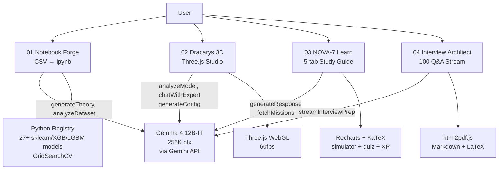

# 🏗️ GALACTIC ML — Architecture

## One-liner
4 React+Vite SPAs + 1 Python registry, all calling **one Gemma 4 model** (`gemma-4-12b-it`) via `@google/genai` / REST.

## System Diagram

## Per-Module Flow

### 01 Notebook Forge (G1)
`Upload CSV (PapaParse) → analyzeDataset(Gemma) → pick target + 2-5 models → notebookGenerator.ts (18 cells) → theory via Gemma → download .ipynb/.py`
- Preprocessing: median/mode impute, dedup, label-encode, IQR clip, StandardScaler, 60/20/20 split
- Tuning: GridSearchCV 5-fold, pre-set grids per model
- DB: Supabase `generated_notebooks` + `generation_logs`

### 02 Dracarys 3D (G2)
`Home search ("GPT") → generateConfigFromModelName(Gemma→JSON) → ThreeScene render → chat/optimize/steps(Gemma)`
- Modes: NEURAL_ARCH, CLUSTERING, DECISION_BOUNDARY, LOSS_LANDSCAPE, GENERAL_ML, etc.
- Export: PNG snapshot + GLB

### 03 NOVA-7 Learn (G3)
`Comms Uplink input → generateResponse(Gemma, NOVA_SYSTEM_PROMPT) → JSON studyGuide? → 5 tabs render`
- Tabs: Core Mechanics / Tactical (radar) / Engine Room (code+sim) / Field Ops / Officer Training (quiz+XP)
- Missions refresh every 30s via `fetchDashboardMissions(Gemma)`

### 04 Interview Architect (G4)
`Topic → SYSTEM_PROMPT + userPrompt → generateContentStream(Gemma, 16K tokens) → MarkdownRenderer (KaTeX) → PDF`
- Format: Q1-10 deep dive, Q11-50 core, Q51-100 rapid fire, + coding challenge

## Tech Stack (unified)

- Frontend: React 18/19 + TS + Vite + Tailwind + Lucide
- 3D: Three.js / R3F (G2)
- Charts: Recharts, KaTeX, react-markdown (G3/G4)
- AI: `@google/genai` ^1.33 / ^1.38, model `gemma-4-12b-it`
- Python: sklearn, xgboost, lightgbm, catboost (G1 registry)
- DB: Supabase (G1 only)

## Why this impresses jury
1. **One brain, four bodies** — same Gemma 4 everywhere = coherent story, easy to maintain.
2. **Full ML lifecycle** — data → model → intuition → knowledge → job.
3. **Real engineering** — GridSearchCV, 5-fold CV, stratified splits, JSON-schema enforcement, streaming, PDF.
