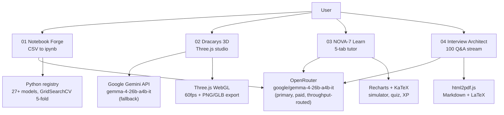

# 🌌 Galactic ML — from raw CSV to job-ready ML engineer, powered by Gemma 4

[](https://hacktoberfest.com/)
[](https://ai.google.dev/gemma)
[](https://react.dev/)
[](./LICENSE)

> **One sci-fi universe, four missions:** Create → Visualize → Learn → Get Hired — every AI call running on **Gemma 4 (`gemma-4-26b-a4b-it`)**.

Originally 4 separate repos (`G1`–`G4`) on Gemini, now merged here and migrated to Gemma 4 with an OpenRouter + Google dual API path. Built for Hacktoberfest: pick a module, run it locally, ship an issue/PR.

## 🚀 Live demos

| Module | Live URL | Status |
|--------|----------|--------|
| 01 Notebook Forge (G1) | https://galbook.galactic.peakso.in/ | ✅ Production (Cloudflare Pages `galbook`) |
| 03 NOVA-7 Learn (G3) | https://galactic-ml-nova-7.pages.dev | ✅ Production (Cloudflare Pages `galactic-ml-nova-7`) |
| 04 Interview Architect (G4) | https://interview-architect-ai.pages.dev | ✅ Production (Cloudflare Pages `interview-architect-ai`) |
| 02 Dracarys 3D (G2) | Run locally (`:3001`) | 🛠️ Not deployed yet — great first contribution |

## 🛰️ The 4 modules

| # | Folder | Mission | What it does | AI calls (all Gemma 4) |
|---|--------|---------|--------------|------------------------|
| 1 | `G1/` | **Create** — Notebook Forge | Upload any CSV → production-ready Jupyter notebook (18 cells): EDA, preprocessing, GridSearchCV tuning, model comparison charts, deployment code. Python registry with 27+ sklearn/XGB/LGBM models. | `analyzeDataset`, `generateTheoryContent`, `generateCheatSheet` (parallel prefetch, cached, throughput-routed) |
| 2 | `G2/` | **See** — Dracarys 3D Studio | Words → interactive 3D ML world (Three.js): neural nets, clustering, decision boundaries, loss landscapes. AI chat explains what you see, suggests optimizations. | `generateConfigFromModelName`, `analyzeModel`, `chatWithExpert`, `generateSteps` |
| 3 | `G3/` | **Learn** — NOVA-7 Tutor | Sci-fi AI officer: “Search Transformer” → 5-tab study guide (math/KaTeX, radar stats, runnable PyTorch skeleton, hyperparam simulator, pitfalls, quiz + XP). Missions refresh every 30s. | `generateResponse` (JSON-schema study guides), `fetchDashboardMissions` |
| 4 | `G4/` | **Hired** — Interview Architect | Streams exactly 100 interview Q&A (10 deep + 40 core + 50 rapid-fire) + coding challenge for any topic, Markdown + LaTeX render, PDF/print export. | `streamInterviewPrep` (OpenRouter SSE streaming, 16K tokens) |

`GALACTIC-ML/` holds jury/demo docs: `README.md` (story) → `ARCHITECTURE.md` → `JURY-GUIDE.md` (5-min pitch) → `GEMMA-4-MIGRATION.md` → `DEMO-CHECKLIST.md`.

## 🏗️ Architecture



### Design decisions

- **One brain, four bodies:** single canonical model `gemma-4-26b-a4b-it` (MoE, 256K context) everywhere. `gemma-4-12b-it` is HF/local-only (404 on the Gemini API); `gemma-4-31b-it` is the drop-in quality upgrade via one env var.
- **Dual API path:** OpenRouter first (bypasses the account's Google per-project quota = 0), Google `generateContent(_Stream)` fallback. Keys only from `.env`, never committed.
- **Speed:** parallel AI prefetch, 800–1000 token caps with tight prompts, temperature 0.3, `provider: { sort: 'throughput' }`, `localStorage` theory cache (repeat runs near-instant).
- **Frontend:** React 18/19 + TypeScript + Vite + Tailwind + Lucide; Supabase only in G1 (notebook history).

## ⚡ Quick start (local)

```bash
# 1. Keys — OpenRouter recommended (paid Gemma, works despite Google quota 0).
#    Google AI Studio key alone will 429 on this account's project.
cp GALACTIC-ML/.env.example G1/.env   # repeat for G2/G3/G4
# G1/.env needs:
#   VITE_OPENROUTER_API_KEY=sk-or-...
#   VITE_OPENROUTER_MODEL=google/gemma-4-26b-a4b-it
#   VITE_GEMMA_API_KEY=AIza...  (fallback)
#   VITE_GEMMA_MODEL=gemma-4-26b-a4b-it

# 2. Run (4 terminals):
cd G1 && npm install && npm run dev              # http://localhost:5173
cd G2 && npm install && npm run dev -- --port 3001
cd G3 && npm install && npm run dev -- --port 3002
cd G4 && npm install && npm run dev -- --port 3003
```

Python side (G1 registry):

```bash
pip install -r G1/requirements.txt
python G1/comprehensive_model_registry.py
python GALACTIC-ML/shared/gemma.config.py
```

## ☁️ Deployment (Cloudflare Pages + Wrangler)

```bash
cd G1 && npm run build   # embeds VITE_* from .env at build time
npx -y wrangler@latest pages deploy ./dist --project-name galbook --branch production --commit-dirty=true
# G3 -> --project-name galactic-ml-nova-7 --branch main
# G4 -> --project-name interview-architect-ai --branch production
```

Custom domains are already attached (`galbook.galactic.peakso.in`). Never commit `.env` — root `.gitignore` covers `**/.env`.

## 🎃 Contributing for Hacktoberfest

Good first issues: deploy `G2` to Pages (no deployment yet), replace G2/G3/G4 `process.env` reads with a shared `shared/gemma.config.ts` import, add Tailwind PostCSS build to G3/G4 (drop the CDN warning), code-split the ~1MB G3/G4 bundles, add `prefers-reduced-motion` to the 3D studio, write Playwright smoke tests for Upload→Generate.

```bash
git clone https://github.com/abcreativeakshay/galactic-ml-gemma4.git
cd galactic-ml-gemma4
# work in G1|G2|G3|G4, keep PRs scoped to one module + update its README section
```

## 📄 License

MIT — see [LICENSE](./LICENSE).
